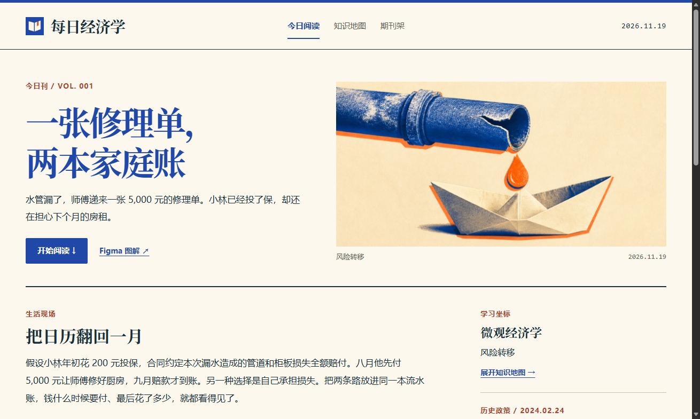

# 每日经济学

每日经济学是一份可以装进桌面版 Chrome 或 Microsoft Edge 的中文图解杂志。它写给想借助日常新闻和生活问题读懂微观、宏观、发展经济学的读者，无需专业基础。

每期用一个生活场景讲清一个正式概念，再用账本、对照表或收益矩阵把推理展开。想沿着学科读，可以打开「知识地图」。想从感兴趣的故事读，可以翻「期刊架」。正文和图表随插件提供。



## 先读一个例子：涨了工资的早餐篮

小林的月工资从 5,000 元涨到 5,100 元。她常买的面包、鸡蛋和牛奶，去年一篮 10 元，今年同样一篮要 10.50 元。假设分量和质量都一样，用这只篮子作尺子，可以看见工资条上看不到的变化。

| 用什么比较 | 去年 | 今年 |
|---|---:|---:|
| 月工资 | 5,000 元 | 5,100 元 |
| 一篮相同早餐的价格 | 10.00 元 | 10.50 元 |
| 工资折合多少篮 | 500 篮 | 约 485.7 篮 |

**名义收入**是工资条上的金额，本例上涨了 2%。**实际购买力**取决于钱能换来多少东西。小林用今年的工资除以今年的篮子价格，得到约 485.7 篮；与去年的 500 篮相比，以早餐为尺度的购买力下降约 2.9%。如果商店只卖整篮，她实际最多买 485 篮。

这些数字是教学假设。要了解总体物价，需要把住房、交通等更多消费项目也纳入，并考虑它们在家庭支出中的权重。这就是从一张早餐小票走向居民消费价格指数（CPI）的第一步。[本期数据与讲解](issues/2026-11-22.json) · [英格兰银行对通胀的解释](https://www.bankofengland.co.uk/explainers/what-is-inflation)

## 安装与第一次阅读

1. 在本仓库页面选择 **Code → Download ZIP**，把 ZIP 解压到打算长期保留的目录。也可以克隆仓库。
2. 在地址栏打开 `chrome://extensions` 或 `edge://extensions`，开启「开发者模式／开发人员模式」。
3. 点击「加载已解压的扩展程序」，选中解压目录里面的 **`extension` 文件夹**。`manifest.json` 就在这一层。
4. 在浏览器扩展菜单中点击「每日经济学」。首页的「开始阅读」会进入案例，「Figma 图解」打开本期杂志定稿。可把书页图标固定到工具栏。

**只想先翻一翻**：解压后双击 [extension/index.html](extension/index.html)，即可离线阅读正文和表格。Windows 用户也可以双击 [open-reader.cmd](open-reader.cmd)，启动器会使用本机 Python 3 获取官方资讯，然后用默认浏览器打开；没有 Python 时会打开离线版。常规浏览器扩展无需 Python。

## 首批四期

| 刊期 | 从生活里的哪件事出发 | 学到什么 |
|---|---|---|
| [11 月 19 日](issues/2026-11-19.json) | 小林一月交 200 元保费，八月垫付 5,000 元维修费，九月才收到赔款。 | 风险转移和风险共担，以及家庭在赔款到账前为什么还需要现金。 |
| [11 月 20 日](issues/2026-11-20.json) | 周六下午只能去代班或野餐。若代班是最佳备选，赴约就放弃了三小时的工作机会和 120 元收入。 | 机会成本是被放弃的最佳可行替代方案的价值。 |
| [11 月 21 日](issues/2026-11-21.json) | 左右两家咖啡店分别决定是否降价。按表里假设的利润，双方都降价时各赚 80 元，单独改回原价只赚 50 元。 | 如何从双方的最优反应读出一个纳什均衡。 |
| [11 月 22 日](issues/2026-11-22.json) | 工资涨了 2%，同一篮早餐却贵了 5%。 | 名义收入、实际购买力，以及个人消费与总体物价的关系。 |

首批刊期为 **2026 年 11 月 19 日至 22 日**。学习地图还覆盖金融市场、发展与国际经济、家庭理财等方向。例子里的金额与收益矩阵均按各期明确写出的条件设置。

## 每天会更新什么

- **日刊**按北京时间展示已到刊期的最新文章。已排期内容可以在期刊架预读。排期结束后，首页显示「最近一期」和真实刊期。后续原创文章、Canva 配图与 Figma 定稿由编辑加入仓库；要取得增刊，更新本地项目文件并重新打开阅读页。
- **政策与数据**在打开今日阅读页时检查近七日的官方发布。插件从[中国财政部](https://www.mof.gov.cn/zhengwuxinxi/caizhengxinwen/)、[国家统计局](https://www.stats.gov.cn/wzgl/rss/)、[英国财政部](https://www.gov.uk/government/organisations/hm-treasury)和[美联储](https://www.federalreserve.gov/feeds/feeds.htm)筛选条目。随文历史剪报与近期发布合计最多两条。每条保留机构、日期及原文入口，「阅读角度」按经济学主题匹配。某个来源暂时不可用时，页面会显示更新状态，并可使用仍在时效内的缓存。
- **阅读进度**保存在当前浏览器本地。扩展申请的站点访问权限限于上述四个机构的发布站点，用来读取栏目与订阅源。历史事件在文中标注为历史剪报。

## 维护与校验

每个刊期的可编辑原文在 [issues/](issues/)。新增一期时，按日期创建 JSON，写明学科、概念、生活场景、图表、关键假设及出处，填入 Figma 定稿链接。已有配图放在 [extension/assets/](extension/assets/)。

用 Python 3.9 或以上版本运行：

```shell
python tools/publish.py
```

发布器校验刊期、学科、表格列数、图片和链接，再生成插件读取的 `extension/catalog.js`。提交增刊时应同时包含刊期源文件和更新后的刊目。[长期编辑约定](AGENTS.md)记录了选题与视觉原则。

Windows 上可用 `python tools/check_reader.py` 在临时 Edge 配置中验证加载、换日选刊、阅读状态、知识地图和窄屏排版。此项开发测试另需 Python 的 `requests` 和 `websocket-client`。
